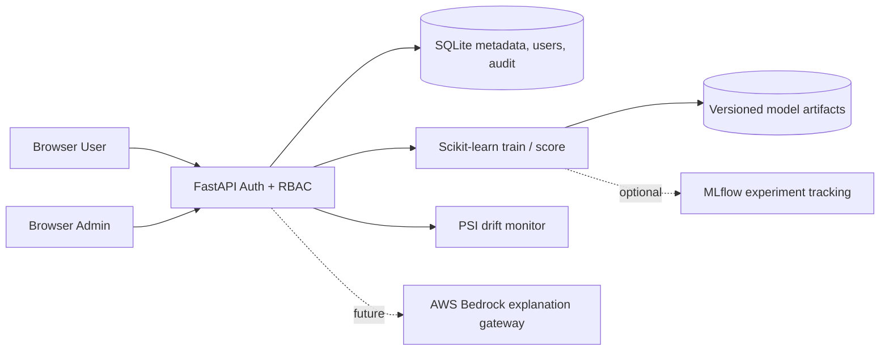

# Architecture document

## Context
Browser → FastAPI on localhost:7005 → SQLite metadata + versioned joblib artifacts. FastAPI hosts HTML/CSS/JS; no Node runtime. Scikit-learn trains LogisticRegression in process. Built-in PSI monitors reference vs simulated incoming amount distribution. Optional MLflow SDK can log experiment metrics to local file store when installed and enabled.

## ADR-001: one container
Decision: static frontend served by FastAPI, SQLite, scikit-learn. Rationale: 1 GB limit, minimal operations. Tradeoff: single instance and synchronous training; cannot scale horizontally with local SQLite.

## ADR-002: logistic regression baseline
Decision: scaled logistic regression with balanced classes. Rationale: quick CPU training, transparent coefficients, strong baseline. Tradeoff: may miss nonlinear fraud patterns; future challenger HistGradientBoosting/XGBoost must earn promotion by measured cost-adjusted performance.

## ADR-003: local registry first
Decision: SQLite candidate/active/archived records and joblib artifacts. Rationale: functional governance without heavy MLflow server. Tradeoff: not equivalent to MLflow Model Registry. Future: MLflow tracking server + external registry service, signed artifacts and S3.

## ADR-004: PSI first
Decision: self-contained PSI drift monitor. Rationale: low memory, explainable. Tradeoff: univariate amount drift is insufficient; future Evidently reports and performance monitoring with delayed labels.

## AWS target
CloudFront/S3 static assets (optional) → WAF/ALB → ECS Fargate FastAPI → RDS PostgreSQL, S3 artifact bucket, CloudWatch, Secrets Manager, IAM. MLflow tracking on separate managed service/container with database and S3 artifact storage. Bedrock only for optional foundation-model inference. Fargate task size must follow supported CPU/memory combinations; **1 GB local cap is not a promise of 1 GB production suitability**.
